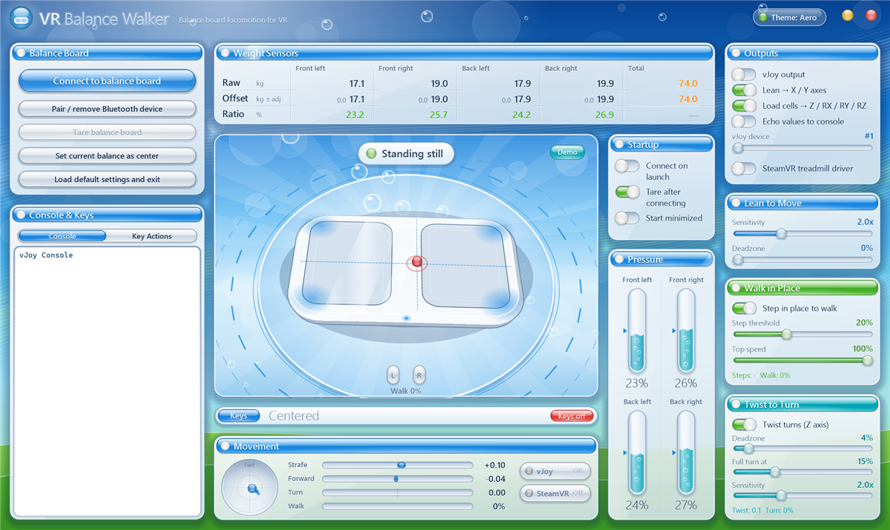
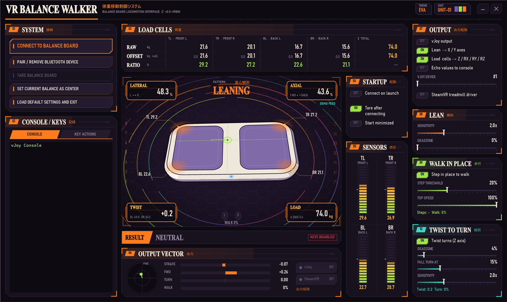
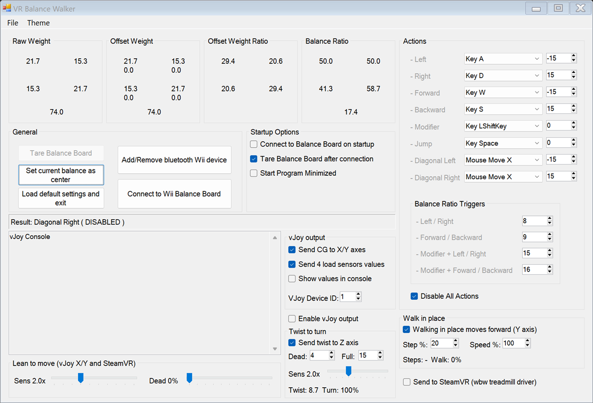

# VR Balance Walker

Stand on a Wii Balance Board, lean to walk and twist to turn. It works in SteamVR games like VRChat through its own treadmill driver, and in flat-screen games through the vJoy virtual joystick.

This is a fork of [WiiBalanceWalker](https://github.com/lshachar/WiiBalanceWalker) by Shachar Liberman (and Richard Perry before that). The original readme is further down.

**[Download the installer](https://github.com/Nixntric/VRBalanceWalker/releases/latest)**: one setup file with the app, the SteamVR driver and (optionally) vJoy. It sets up SteamVR for you. [installer/README.txt](installer/README.txt) explains every SteamVR setting in case you want to do it by hand.

## What's new in this fork

- **SteamVR treadmill driver** (`steamvr_driver/`). The board shows up in SteamVR as a treadmill device, so games read it as real VR locomotion. It comes with a VRChat binding that works out of the box: lean = move, twist = turn, board button = jump.
- **Twist to turn**: twist your hips to turn, with adjustable deadzone, full-turn point and sensitivity. Sent to SteamVR and to vJoy's Z axis, which shows up as the right stick X in browsers and SDL games.
- **Lean to move**: sensitivity and deadzone controls for the lean.
- **Walk in place**: step in place to walk forward. Speed follows your step rate.
- **vJoy fix**: the original sent a centred stance as full left on current vJoy. The axes are now remapped to vJoy's real range.
- **New interface** with live 3D board and themes: Aero (default), EVA (three colour units) and Debloated (the classic WinForms layout). There may also be a hidden one.
- **Installer** (`installer/`, Inno Setup). Registers the driver with SteamVR, turns on `activateMultipleDrivers`, installs vJoy if needed, and cleans up when uninstalled.
- **Raw sensor feed**: WebSocket on `ws://127.0.0.1:26791`, one JSON message per board reading, for browser games.

| EVA | Debloated |
|---|---|
|  |  |

## Requirements

- Windows 10/11 64-bit with Bluetooth, and a Wii Balance Board
- SteamVR for VR games. Works with any headset SteamVR supports (Quest via Link/Air Link/Virtual Desktop, Index, ...).
- vJoy 2.1.9.1 for flat-screen games (the installer can install it)

## Building

| Part | How |
|---|---|
| App | `C:\Windows\Microsoft.NET\Framework\v4.0.30319\MSBuild.exe WiiBalanceWalker\WiiBalanceWalker.csproj /p:Configuration=Release /p:Platform=x86` (C# 5, .NET Framework 4, no Visual Studio needed) |
| SteamVR driver | `steamvr_driver\build.bat` (needs Visual Studio or Build Tools with the C++ x64 tools; uses the bundled OpenVR 2.5.1 driver header) |
| Installer | Put [vJoySetup.exe 2.1.9.1](https://github.com/jshafer817/vJoy/releases/tag/v2.1.9.1) in `installer\redist\vJoySetup-2.1.9.1.exe` (optional), then run `installer\build.cmd` (needs [Inno Setup 6](https://jrsoftware.org/isdl.php)) |

The SteamVR driver listens for the app on UDP `127.0.0.1:26790`. When it gets no data for 0.5 s it sends zero, so you stop walking.

---

## Original WiiBalanceWalker readme

### WiiBalanceWalker v0.5 - by Shachar Liberman
#### WiiBalanceWalker v0.4 and before - Released by Richard Perry from GreyCube.com - Under the Microsoft Public License.
 
[Uses lshachar's WiimoteLib DLL  ](https://github.com/lshachar/WiimoteLib) 
[Uses the 32Feet.NET bluetooth DLL](http://32feet.codeplex.com) 
[Uses vJoy device driver (by Shaul Eizikovich)]( http://vjoystick.sourceforge.net/) 
(Previous to  v0.5 [VJoy by headsoft](http://headsoft.com.au/index.php?category=vjoy) was used) 
***

### WiiBalanceWalker v0.5 progress over v0.4:
	o Virtual joystick Support for x64 systems
	o Can send values directly measured from each of the load sensors, to the virtual joystick interface.
	o Instructions for adding / removing bluetooth devices updated for windows 10. 
	o Easier to make permanent connections with the balance board by using permanent PIN code
	o New startup options makes usage even easier
	o New option to tare the balance board (makes all current measurments zero. use this button while you're off the balance board)
	o Measured values are now in real kilograms (previously they were 4 times too large)
	o Added some helpful tooltips, try to hover your mouse over things to get some explanations.

Get your compiled archive in the [Releases section](https://github.com/lshachar/Wiibalancewalker/releases) 
For virtual joystick support, [install vJoy by Shaul Eizikovich](http://vjoystick.sourceforge.net/site/index.php/download-a-install/download) 
Feel free to [put some bread in my jar](https://paypal.me/lshachar?locale.x=en_US), only if you feel like it!

A tip from user Bobbsterman - [Quick recommendation:](http://www.youtube.com/watch?v=crKoQWvGRok&ab_channel=EthanMuller) It was very useful for setting up the permanent pairing. Wasn't clear to me until watching this that permanent pairing MUST be done through the Windows Bluetooth Settings and not the Control Panel). Cheers!